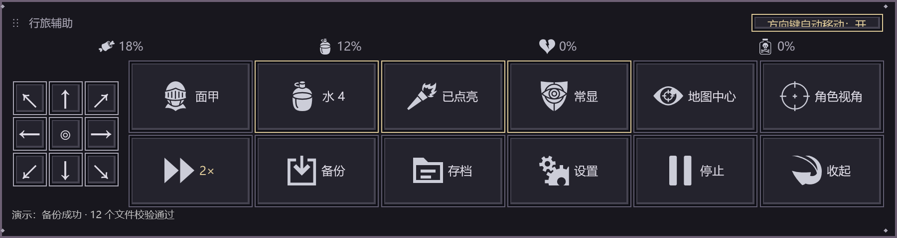
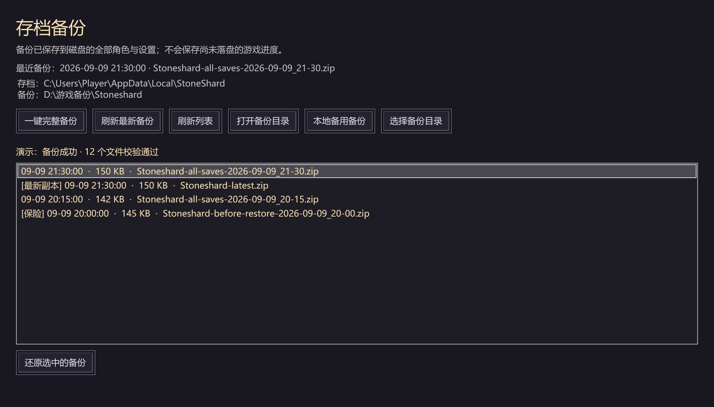

# Stoneshard Companion · 晶石助手

**少一点重复操作，多一点冒险时间。**

为《Stoneshard／紫色晶石》玩家制作的非官方开源辅助工具。把走图、变速、补给、采集、角色信息和存档管理集中在一块可拖动、可缩放的悬浮面板里，也为想调整流派的玩家提供按点退回的选择。

[](https://github.com/tidus2005/stoneshard-companion/releases/latest)
[](LICENSE)
[](https://github.com/tidus2005/stoneshard-companion/releases/latest)

**[下载最新免安装版](https://github.com/tidus2005/stoneshard-companion/releases/latest)** · [使用说明](docs/使用说明.md) · [更新记录](https://github.com/tidus2005/stoneshard-companion/releases) · [反馈问题](https://github.com/tidus2005/stoneshard-companion/issues)

当前版本 **v0.3.36**，适配 **Windows 10/11 x64 · Steam Stoneshard 0.9.4.25 / Build 24780451**。游戏版本不同可能无法连接，请先核对版本。



> 界面示意：图片由 v0.3.8 的实际 WPF 组件离屏生成，数值和存档条目为演示数据，不是游戏运行截图。新版功能以以下介绍及 [v0.3.36 发行说明](docs/releases/v0.3.36.md)为准。

## 用它能做什么

| 你的需求 | 晶石助手提供的功能 |
| --- | --- |
| 赶路少点几次鼠标 | 九宫格导航、方向键自动移动，沿原版寻路跨一张相邻地图；遇敌、受伤或手动接管时停止 |
| 让探索节奏更顺手 | 面板点击循环切换 1×／2×／3×，快捷键支持 1～4 倍；地面物品名称常显 |
| 少来回翻补给栏 | 一键喝水、切换火把、开合面甲；可选自动喝水与自动保持照明 |
| 按需要收集物资 | 可配置采集种类和保留量、食用蘑菇共享保留组、连续采集；可选战利品背包收纳 |
| 随时了解角色状态 | 饥饿、口渴、疼痛、迷醉，属性关注与变化提示、补给续航和装备耐久提醒 |
| 给进度多留一份备份 | 完整备份、历史列表、快速备份、确认后还原；还原前建立保险备份并校验文件 |
| 调整已经投入的点数 | 用宝石与契约历练逐点退回属性或技能，再到游戏原版界面重新分配 |
| 更方便地查看交战信息 | 实验性战斗悬停卡片，集中展示双方属性、目标状态与普通近战概率估算 |

面板的位置和尺寸会保存，自动功能按需开启。自动行走与补给保留原版寻路、物品和回合消耗；遇敌、菜单、加载或切到后台等情况会停止或等待，具体条件见[使用说明](docs/使用说明.md)。

## 三步开始

1. 在[最新版本页面](https://github.com/tidus2005/stoneshard-companion/releases/latest)的 **Assets** 中下载 `StoneshardCompanion-0.3.36-win-x64.zip`，完整解压到普通文件夹。`Source code` 是源码，不是可运行成品。
2. 双击 `Start.cmd` 或 `StoneshardCompanion.exe`。发行包自带运行时，**无需另装 .NET 或 PowerShell**；保留包内 DLL 和 Assets 等文件，不要只复制 EXE。
3. 启动适配版本的游戏，使用窗口或无边框全屏，把面板拖到顺手的位置，在设置中选择需要的功能。

**从旧版升级：先保存进度，正常退出游戏和旧助手，再启动新版。** v0.3.36 使用 v26 桥接组件，只重启助手无法替换游戏进程中的旧组件。也可在助手设置中检查更新，按提示完成安装。

## v0.3.36：稳定性、快捷存档与出发清单

针对评论反馈，修复桥接窗口回调中的脚本重入风险，减少重复采样并补齐临时对象释放。模组版连接失败时提供具体原因与可复制诊断；未知游戏版本仍停止连接，本版未实现通用模组兼容。

- **Ctrl+Alt+F5 立即存档**：保存当前进度，完成核验与备份后显示原版 Load 中的自动存档槽位；Ctrl+Alt+B 仍只备份已落盘进度。
- **出发清单**：可自行编辑补给、耐久、存档等提醒，每次打开重新勾选。它只帮助记事，不自动获取资源或执行游戏操作。

独立存档副本已完成营地持续运行、短途走图、存档读回和完整快捷保存流程验证；评论中 Rich Presence 报错的具体原因仍待反馈者环境复现。详见[发行说明](docs/releases/v0.3.36.md)与[实机验证记录](docs/验证记录-2026-10-16.md)。

## v0.3.35：更灵活地退点，更集中地查看战斗信息

### 宝石混搭退点，让流派调整更灵活

不必凑固定配方。原版 **14 种宝石**均可组合，所选宝石的**基础价值合计 ≥600**，加上 **1 次历练机会**，即可退回 1 个已投入的属性点或技能点。

- 钻石 ×1 = 600；祖母绿 450 ＋ 紫水晶 150 = 600，均可退回 1 点。
- 可手选宝石和数量，也可自动凑够。按基础价值计算，不随商人报价变化；超出价值不找零，每次只退 1 点，不扣金币。
- 首次启用获得 2 次历练机会，之后每成功交付 1 个契约获得 2 次，上限 6 次。
- 先核验点数返还，再扣材料与历练，并显示点数前后变化。提交后结果不确定时锁定重复操作，提示核对存档与保险备份。

这是助手自定义的退点规则。使用时需满足城镇／营地、安全状态和技能前置等条件；仅使用主物品栏中的独立宝石，部分角色与技能存在限制。详见[使用说明](docs/使用说明.md)和[退点核验说明](docs/releases/v0.3.33.md)。

### 战斗悬停预览：把双方信息放在一起看

鼠标移到当前可见目标上，在鼠标附近显示三栏卡片：

| 我的攻击 | 目标状态 | 我的防御 |
| --- | --- | --- |
| 准确、失手、暴击、伤害面板、护甲穿透与护甲损伤 | 生命、能量、防护、闪避、格挡、抗性及可读取的活动状态 | 假设对方使用普通近战时的受击概率估算，以及己方闪避、格挡与抗性 |

卡片穿透鼠标，攻击仍使用游戏原有操作。按住 **Alt** 展开更多信息；**Ctrl + Alt + I** 打开可滚动的完整数据快照，**Esc** 关闭快照窗口。

**此功能仍属实验性，尚未完成游戏内验收。** 概率是普通近战模型估算，不是最终伤害承诺；技能、远程／法术、各部位护甲与伤势、状态剩余回合尚未精确适配。选中技能时会提示未适配，不套用普攻概率。详见[战斗预览设计与限制](docs/combat-preview-design.md)。

### 已应用等级补丁的角色，也能继续连接助手

本版支持本项目已知指纹的解除 30 级封顶补丁，并兼容高等级角色的退点／洗点读取。**安装助手不会自动解除等级上限**；补丁位于源码中的 `scripts/level-cap.py`，需要单独备份并应用。超过 30 级后的真实升级、奖励和存读档尚未完成游戏内验收，操作与恢复方法见[等级补丁说明](docs/releases/v0.3.34.md)。

## 存档管理：备份、历史、还原放在一起



*同为 v0.3.8 实际组件离屏预览，条目与路径为演示数据。*

可以一键备份全部角色与设置，保留历史 ZIP，也可刷新一个固定的最新副本。还原前展示所选目标、要求确认，并自动建立当前状态的保险备份；完成后校验文件。支持自选备份目录，备份传输失败时可保留已生成且已校验的本地 ZIP。

**备份只包含已经保存到磁盘的进度。** 推荐先在游戏内保存，回到主菜单或退出游戏，再备份／还原。快速备份不会触发游戏保存；“立即存档”是另一项独立功能，调用原版自动存档，读取时仍需在游戏 Load 界面选择对应槽位。

助手更新不会迁移游戏进度，也不替代 Steam 云同步。共享目录不可用时可改选 Windows 本地目录；完整流程见[存档使用说明](docs/使用说明.md)。

## 适配与验证范围

- **平台与游戏版本：**发行包为 Windows x64 程序，不是 macOS 或 ARM64 原生应用。桥接校验游戏 EXE 与 `data.win`，不匹配时拒绝连接；不承诺兼容其他游戏版本或模组组合。
- **本版发布检查：**v0.3.36 已通过本地离线回归、便携包和更新流程检查；发布工作流重复执行这些检查并校验上传文件的 SHA256。这些检查不等于所有功能都已在真实游戏中验收。
- **已有实机记录：**早期版本覆盖了部分导航、补给、属性展示、存档及退点流程；旧版验证不能代替新增功能的实机验收。战斗预览和超过 30 级后的行为仍需进一步验证。

遇到问题请在 [Issues](https://github.com/tidus2005/stoneshard-companion/issues) 附上助手版本、游戏版本、复现步骤和错误提示；截图或日志请先去掉个人信息。

<details>
<summary>使用说明与验证记录</summary>

- [完整使用说明](docs/使用说明.md)
- [v0.3.36 发行说明](docs/releases/v0.3.36.md)
- [v0.3.35 发行说明](docs/releases/v0.3.35.md)
- [战斗预览设计](docs/combat-preview-design.md)
- [宝石混搭规则（v0.3.32 开发记录，已汇入 v0.3.35）](docs/releases/v0.3.32.md)
- [退点核验与异常处理](docs/releases/v0.3.33.md)
- [等级补丁与恢复](docs/releases/v0.3.34.md)
- [宝石退点早期实机记录](docs/releases/v0.3.31.md)
- [采集、快速备份与读档](docs/releases/v0.3.24.md)
- [导航、补给与属性实测](docs/releases/v0.3.14.md)
- [共享目录备份加固](docs/0.3.8共享目录备份加固.md)
- [全部已发布版本](https://github.com/tidus2005/stoneshard-companion/releases)

</details>

## 构建与参与开发

需要 [.NET 8 SDK](https://dotnet.microsoft.com/download/dotnet/8.0)、[Zig 0.13.0](https://ziglang.org/download/0.13.0/) 和 [PowerShell 7](https://github.com/PowerShell/PowerShell/releases)。Zig 解压至 `.tools/zig-windows-x86_64-0.13.0/`，或加入 PATH。离线构建与测试不需要安装游戏。

```powershell
git clone https://github.com/tidus2005/stoneshard-companion.git
cd stoneshard-companion
pwsh -File scripts/test-offline.ps1
pwsh -File scripts/build.ps1 -Publish
pwsh -File scripts/test-portable.ps1 -ZipPath artifacts/release/StoneshardCompanion-0.3.35-win-x64.zip
```

发布目录位于 `artifacts/release/`，包含免安装 ZIP 与 SHA256 校验文件。GitHub Actions 同样执行构建、离线回归和发行检查，已公开的版本不会覆盖。

| 目录 | 用途 |
| --- | --- |
| `src/Overlay` | WPF 面板与窗口 |
| `src/Core` | 游戏连接、功能策略、布局与存档服务 |
| `native/Bridge` | 游戏主线程适配层 |
| `native/Tests`、`src/Probe`、`tests` | 原生模拟、托管与存档回归检查 |
| `tools`、`research` | 界面预览与研究工具 |

离线回归使用模拟数据与临时存档；**Probe 其他诊断命令可能接触真实游戏**，请先阅读脚本。贡献方式见 [CONTRIBUTING.md](CONTRIBUTING.md)，研究说明见 [research/README.md](research/README.md)。

## 开源与声明

项目免费开源，原创源码与文档采用 [MIT 许可证](LICENSE)。Game-icons.net 图标遵循 [CC BY 3.0 署名](src/Overlay/Assets/Icons/ATTRIBUTION.md)，详见[第三方声明](THIRD_PARTY_NOTICES.md)。

本项目与 Stoneshard 开发商、发行商无隶属关系。发行包不包含游戏程序、游戏素材、个人存档或本机配置；请自行准备适配版本的游戏。欢迎反馈体验、报告问题或提交 Pull Request。

*An open-source Windows companion for Stoneshard: navigation, speed controls, supplies, gathering, save management, gem-based refunds, and an experimental combat preview.*
